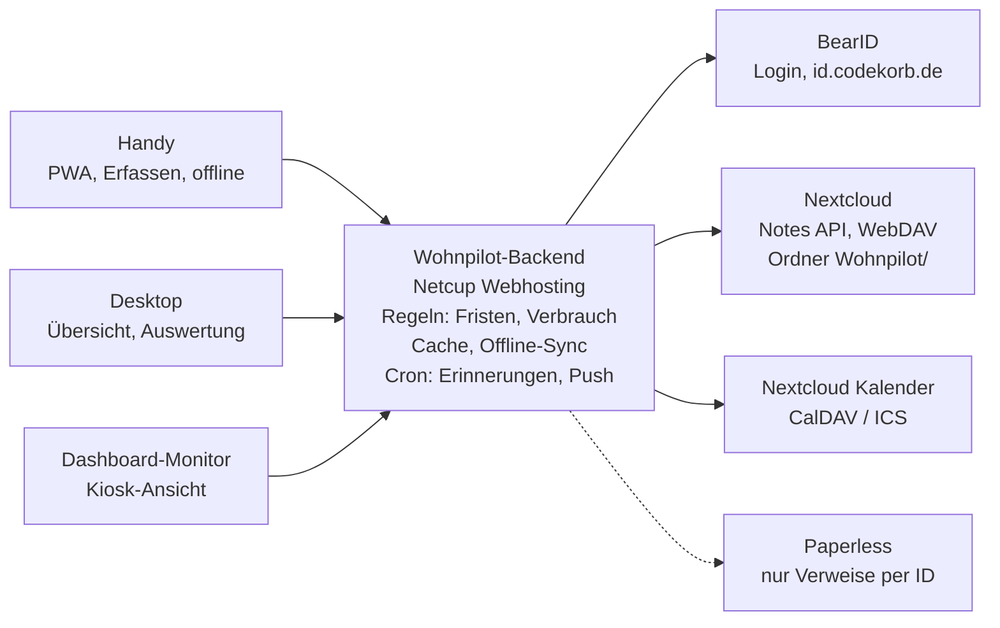

# Wohnpilot – Konzept

Stand: 24.10.2026

## Idee und Leitprinzipien

Wohnpilot ist eine Web-App, die alle haushaltsrelevanten Daten eines Mietobjekts bündelt und sie als lesbare Markdown-Notizen in der eigenen Nextcloud (cloud.codekorb.de) ablegt. Startpunkt ist das gemietete Einfamilienhaus, später soll dieselbe App ohne Umbau für eine Mietwohnung taugen.

- **Daten gehören dir, nicht der App:** Standard ist Nextcloud Notes mit Markdown und YAML-Frontmatter, alternativ SQLite oder eine Datenbank; ein Export als Markdown ist jederzeit möglich. Ohne die App bleibt alles in der Notes-App oder jedem Editor lesbar und bearbeitbar.
- **Eintragen schneller als Vergessen:** Jede häufige Eingabe, etwa ein Zählerstand, braucht höchstens drei Tipper, auch mobil im Keller ohne Netz.
- **Die App rechnet, du nicht:** Fristen, Verbräuche, Fälligkeiten und Hochrechnungen werden aus den Rohdaten abgeleitet, nicht doppelt gepflegt.
- **Mietobjekt-Denken:** Die App unterscheidet, was Mieter und was Vermieter verantworten, und dokumentiert alles, was bei Übergabe, Nebenkostenabrechnung oder Streit zählt.
- **Mehrbenutzer vorbereitet, Einzelnutzer gestartet:** Das Datenmodell kennt Haushalt und Personen von Anfang an, die Oberfläche zeigt davon erst mal nur dich.
- **Keine Geheimnisse:** Passwörter, PINs und Zugangsdaten bleiben in 1Password. Wohnpilot verweist höchstens auf den Eintrag.
- **Teil des Ökosystems:** Login über BearID, Kachel in Bear Cave, Verweise auf Paperless, Termine in den Nextcloud-Kalender, Kacheln für den Dashboard-Monitor.

## Objekt-Modell

Alles hängt an einem **Objekt** (Haus oder Wohnung), das zu einem **Haushalt** gehört. Ein Objekttyp schaltet Module und Vorlagen passend ein, sodass der Wechsel vom Haus zur Wohnung nur ein neues Objekt mit anderem Profil ist.

- **Haushalt:** Personen, die dort leben, und wer mit eintragen darf. Bleibt beim Umzug bestehen.
- **Objekt:** Adresse, Typ, Einzug, ggf. Auszug, Wohnfläche, Räume, Vermieter. Zu einem Zeitpunkt ist genau ein Objekt aktiv, alte werden archiviert, nicht gelöscht.
- **Räume und Orte:** Keller, Küche, Garten, Dachboden. Zähler, Geräte und Mängel lassen sich einem Raum zuordnen.
- **Einträge:** Alles Weitere (Zähler, Verträge, Geräte, Termine, Mängel, Wissen) gehört zu einem Objekt oder, wie Versicherungen und Handyvertrag, zum Haushalt und zieht mit um.

| Bereich | Einfamilienhaus (Miete) | Mietwohnung |
| --- | --- | --- |
| Zähler | Strom, Gas/Öl oder Wärmepumpe, Wasser, ggf. Gartenwasser, PV | Strom, ggf. Gas; Wasser und Heizung oft per Heizkostenverteiler über die Verwaltung |
| Mieterpflichten | Garten, Winterdienst, Gehweg, ggf. Mülltonnen rausstellen, Dachrinne je nach Vertrag | Treppenhaus-Reinigung laut Hausordnung, Keller, Balkon |
| Ansprechpartner | Vermieter direkt | Hausverwaltung, Hausmeister |
| Nebenkosten | Viele Verträge selbst (Müll, Wasser, Schornsteinfeger) oder Umlage | Fast alles über die Betriebskostenabrechnung |
| Termine | Schornsteinfeger, Heizungs- und Gartenarbeiten, Müllabfuhr | Ableser, Rauchmelderwartung durch Dienstleister |

Beim **Umzug** erzeugt die App aus dem alten Objekt eine Auszugs-Checkliste (Endstände ablesen, Ummeldungen, Übergabeprotokoll, Kaution zurück) und aus dem neuen eine Einzugs-Checkliste. Verträge, die zum Haushalt gehören, wandern mit, objektgebundene enden.

## Einrichtung

Beim ersten Start fragt ein kurzer Assistent nur ab, was Module, Vorlagen und Erinnerungen bestimmt. Alles bleibt später in den Einstellungen änderbar.

1. **Speicherort:** Nextcloud Notes (Standard, Daten als Markdown), SQLite auf dem Server oder eine MySQL/MariaDB-Datenbank. Alle drei hängen an derselben Speicher-Schnittstelle; ein Wechsel läuft über Export und Import.
2. **Objekt:** Haus oder Wohnung, Adresse, Einzug, Wohnfläche, Räume aus einer Vorschlagsliste zum Antippen.
3. **Heizung:** Mehrfachauswahl, weil oft kombiniert, etwa Gasheizung plus Kaminofen. Jede Wahl schaltet passende Zähler, Wartungen und Termine ein (Tabelle unten).
4. **Zähler:** Art und Anzahl, z. B. 1× Strom, 2× Wasser, 1× Gartenwasser, jeweils mit Raum. Daraus entstehen die Zähler-Einträge und die Reihenfolge der Ablese-Runde.
5. **Müll:** Tonnen mit Rhythmus oder Import des Abfuhrkalenders (ICS). Jede Tonne erscheint in ihrer Farbe (Restmüll grau, Bio braun, Papier blau, Gelbe Tonne gelb, Glas grün); die Farbe ist anpassbar, weil sie je Kommune abweicht. Schalter „Tonnen selbst rausstellen“: aus bei Vollservice, dann zeigt die App die Abholung nur als Info, ohne Erinnerung.
6. **Mieterpflichten:** Häkchen für Garten, Winterdienst, Treppenhaus und die Kleinreparaturgrenze aus dem Mietvertrag.
7. **Erinnerungen:** Push an oder aus, Kalender-Feed, Ablesetag im Monat.

| Heizform | schaltet ein |
| --- | --- |
| Gas | Gaszähler, Heizungswartung, Schornsteinfeger mit Abgasmessung |
| Öl | Tankfüllstand per Eintrag, Nachkauf mit Menge und Preis, Schornsteinfeger |
| Pellets | Lagerstand, Bestellungen mit Menge und Preis, Lagerraum reinigen, Schornsteinfeger |
| Wärmepumpe | eigener Stromzähler oder Tarif, Filter und Wartung, Wärmemengenzähler falls vorhanden |
| Fernwärme | Wärmemengenzähler, Abrechnung über Versorger oder Vermieter |
| Kamin oder Kaminofen | Schornsteinfeger mit Kehrterminen und Feuerstättenschau, Holzvorrat in Raummetern, Dichtungen und Asche prüfen |

## Module und Inhalte

Zehn Module decken den Haushalt ab; Zähler und Mietverhältnis bringen bei einem Mietobjekt den größten Nutzen und kommen zuerst.

### Zähler und Verbrauch

- Zählerart, Zählernummer, Einheit, Ort, Messstellenbetreiber, Tarif (Arbeits- und Grundpreis), Abschlag
- Ablesungen mit Datum, Wert, Foto und Anlass (regulär, Stichtag, Einzug, Auszug, Zählerwechsel)
- Zählerwechsel sauber abbilden: alter Endstand, neuer Anfangsstand, Verbrauch läuft durch. In der Notiz sind das zwei Zeilen mit demselben Datum und dem Anlass „Zählerwechsel“; die untere ist der Endstand des alten, die obere der Anfangsstand des neuen Zählers
- Zweitarif-Zähler (HT/NT) und Einspeisezähler bei PV
- Plausibilitätsprüfung: kleiner als der letzte Wert, ungewöhnlicher Sprung, Ablesung überfällig
- Abgeleitet: Verbrauch pro Tag, Monat und Jahr, Vorjahresvergleich, Hochrechnung aufs Abrechnungsjahr, Kosten und ob der Abschlag reicht
- Optional Gradtagzahlen für die Heizung, damit milde und kalte Winter vergleichbar werden

### Mietverhältnis

- Mietvertrag: Beginn, Kaltmiete, Nebenkostenvorauszahlung, Staffel- oder Indexmiete, Kündigungsfrist
- Kaution: Höhe, Art (Konto, Bürgschaft), wo hinterlegt, Rückforderung beim Auszug
- Mieterhöhungen als Historie mit Datum, Grund und Prüffrist (Zustimmung binnen zwei Monaten)
- Wichtige Klauseln zum Nachschlagen: Kleinreparaturen (Einzelbetrag, Jahresgrenze), Schönheitsreparaturen, Tierhaltung, Garten
- Übergabeprotokoll Einzug mit Fotos je Raum und Zählerständen, später Grundlage für den Auszug
- Kommunikation mit dem Vermieter: Datum, Kanal, Inhalt, Antwort, Verweis aufs Schreiben in Paperless

### Nebenkosten und Betriebskostenabrechnung

- Jede Abrechnung erfassen: Zeitraum, Gesamtkosten, Vorauszahlungen, Nachzahlung oder Guthaben, neue Vorauszahlung
- Positionen je Kostenart (Wasser, Müll, Grundsteuer, Versicherung, Heizung) für den Vorjahresvergleich
- Fristen: Zugang spätestens 12 Monate nach Abrechnungszeitraum, Einwände 12 Monate nach Zugang, Belegeinsicht anfragen
- Abgleich mit eigenen Zählerständen: passt der abgerechnete Verbrauch zu dem, was du abgelesen hast
- Steuer: haushaltsnahe Dienstleistungen und Handwerkerleistungen aus der Abrechnung fürs Jahr sammeln

### Verträge und Versicherungen

- Strom, Gas, Internet, Mobilfunk, Rundfunkbeitrag, Streaming, Hausrat, Haftpflicht, Glas, ggf. Rechtsschutz
- Anbieter, Vertragsnummer, Kosten, Zahlungsrhythmus, Beginn, Mindestlaufzeit, Kündigungsfrist, Bonus-Ende
- Abgeleitet: „spätestens kündigen bis“, Erinnerung mit Vorlauf, Kosten pro Monat und Jahr gesamt
- Preisänderungen mit Sonderkündigungsrecht als eigene Frist
- Hausrat: Versicherungssumme gegen Wohnfläche prüfen (Unterversicherungsverzicht) und bei Umzug anpassen

### Geräte und Inventar

- Gerät, Hersteller, Modell, Seriennummer, Kaufdatum, Händler, Preis, Garantie- und Gewährleistungsende
- Eigentum markieren: deins oder vom Vermieter (Einbauküche, Heizung, Rauchmelder) – wichtig für Reparatur und Auszug
- Anleitung und Rechnung als Verweis auf Paperless, Ersatzteile und Verbrauchsmaterial mit Bestellnummer
- Wertvolle Dinge mit Foto als Nachweis für die Hausratversicherung

### Wartung und wiederkehrende Aufgaben

- Aufgaben mit Intervall statt festem Datum: Rauchmelder testen, Heizkörper entlüften, Siphon und Abfluss, Dunstabzugsfilter, Kaffeemaschine entkalken, Wasserfilter, Dachrinne, Rasenmäher einwintern
- Zuständigkeit: Mieter, Vermieter oder Dienstleister, damit klar ist, wen man anruft
- Saisonal: Außenwasserhahn vor Frost absperren, Gartenschlauch rein, Winterdienst-Ausrüstung prüfen
- Erledigt-Historie mit Datum, Person und Notiz, auch als Nachweis gegenüber dem Vermieter

### Termine und Pflichten am Haus

- Müllabfuhr je Tonne (Rest, Bio, Papier, Gelb) mit Rhythmus; Erinnerung zum Rausstellen nur, wenn bei der Einrichtung gewählt
- Schornsteinfeger, Heizungswartung, Ablesetermine, Rauchmelderwartung durch Dienstleister
- Mieterpflichten beim Einfamilienhaus: Winterdienst ab 7 Uhr (laut Ortssatzung), Gehweg kehren, starker Heckenschnitt nur von Oktober bis Februar (Schonzeit nach Naturschutzgesetz)
- Einmalige Termine: Handwerker, Besichtigung durch Vermieter, Sperrmüll

### Mängel und Reparaturen

- Mangel mit Raum, Fotos, Datum entdeckt, Datum gemeldet, Kanal und Status (gemeldet, bestätigt, Handwerker terminiert, behoben)
- Frist zur Mängelbeseitigung und Erinnerung zum Nachfassen
- Kleinreparaturen: Kosten pro Fall und Summe im Jahr gegen die Grenze aus dem Mietvertrag
- Bei längeren Mängeln: Zeitraum festhalten, falls eine Mietminderung im Raum steht

### Wissen und Stammdaten

- Wo ist was: Haupthahn, Gashahn, Sicherungskasten mit Belegung je Raum, FI-Schalter, Absperrventile, Heizungsanlage
- Kennwerte: Wandfarben mit Hersteller und Farbton, Glühbirnen je Lampe, Maße von Fenstern für Rollos
- Bedienung: Heizung umstellen, Rollladen einlernen, WLAN-Netzname (das Passwort steht in 1Password)
- Notfallblatt: was tun bei Wasserrohrbruch, Stromausfall, Gasgeruch, mit den wichtigsten Nummern

### Kontakte

- Vermieter, Hausverwaltung, Nachbarn mit Schlüssel, Handwerker nach Gewerk, Schornsteinfeger, Stadtwerke, Störungsnummern
- Jeder Kontakt verlinkt zu den Einträgen, in denen er vorkommt

## Erfassung

Die App ist eine PWA, die vom Homescreen startet und auf dem Handy jede häufige Eingabe in drei Schritten erledigt: Typ wählen, Wert eintragen, speichern.

- **Ein „+“ für alles:** Zentrale Schaltfläche, danach Auswahl Zählerstand, Termin, Frist, Mangel, Gerät, Notiz. Die zuletzt genutzte Auswahl steht oben.
- **Formulare aus Vorlagen:** Jeder Typ hat eine Vorlage mit Feldern, Pflichtfeldern und Vorgaben (Datum heute, Objekt aktiv). Die App schreibt Frontmatter und Tabellenzeilen, Markdown tippst du nie von Hand.
- **Zählerstand per Foto:** Foto aufnehmen, OCR schlägt die Ziffern vor, du bestätigst. Das Foto wird als Beleg an die Notiz gehängt.
- **QR-Aufkleber:** Am Zähler, am Gerät oder an der Heizung öffnet ein QR-Code direkt das passende Formular bzw. die Detailseite.
- **Offline-Warteschlange:** Ohne Netz im Keller wird lokal gespeichert und später synchronisiert, mit sichtbarem Hinweis „3 Einträge warten“.
- **Teilen-Ziel:** Über das Teilen-Menü landen Fotos, PDFs oder Text als Entwurf in der App, etwa ein Brief des Vermieters.
- **Ablese-Runde:** Ein Modus, der alle Zähler nacheinander abfragt, sortiert nach Standort (erst Keller, dann Garten).
- **Erinnerungen mit Direktsprung:** Push-Nachrichten führen direkt ins richtige Formular, etwa „Monatsende – Zählerstände ablesen“ oder „Morgen Gelbe Tonne“.
- **Nachträglich bearbeiten:** Jeder Eintrag bleibt änderbar, mit Hinweis, wer ihn wann zuletzt geändert hat.

## Übersicht und Auswertungen

Die Startseite beantwortet eine Frage: Was steht in den nächsten 30 Tagen an, und was ist schon überfällig?

- **„Was steht an“:** Fristen, Termine, Wartungen und fällige Ablesungen in einer Liste, nach Dringlichkeit sortiert (überfällig, diese Woche, bald, später).
- **Kennzahlen-Leiste:** Fixkosten pro Monat, Stromverbrauch laufender Monat gegen Vorjahr, offene Mängel, nächste Kündigungsfrist.
- **Verbrauchsdiagramme:** Monatsverbrauch je Zähler mit Vorjahreslinie, Jahreshochrechnung mit Spanne, Kosten gegen Abschläge.
- **Kalender-Feed:** ICS-Abo oder CalDAV-Schreiben in einen eigenen Kalender „Haushalt“ in Nextcloud, damit Termine im normalen Kalender erscheinen.
- **Dashboard-Kacheln:** Eine Kiosk-Ansicht ohne Navigation für den kleinen Monitor: nächste Müllabfuhr, heutige Aufgaben, Verbrauch dieses Monats.
- **Suche:** Volltext über alle Notizen, Filter nach Modul, Raum und Objekt.
- **Berichte:** Jahresbericht (Verbräuche, Kosten, erledigte Wartungen), Steuer-Export für haushaltsnahe Leistungen, Übergabemappe für den Auszug als PDF.
- **Bear Cave:** Kachel mit Zahl der offenen Punkte, Klick führt in Wohnpilot.

## Mehrbenutzer vorbereitet

Zum Start nutzt nur du die App, aber Datenmodell und Ablage sind so angelegt, dass weitere Personen ohne Umbau dazukommen.

- **Haushalt-Ordner:** Alle Daten liegen in einem Nextcloud-Ordner, der später per Nextcloud-Freigabe mit anderen geteilt werden kann.
- **Personen:** Jede Person hat eine BearID-Kennung. Einträge tragen `erstellt_von` und `geaendert_von`.
- **Rollen:** Verwalter (alles), Mitglied (eintragen und abhaken), Gast (nur lesen, z. B. für Haussitter das Notfallblatt). Seit Stufe 6, siehe Festlegungen.
- **Zuständigkeit:** Aufgaben und Wartungen können einer Person zugewiesen werden; Erinnerungen gehen an alle, mit ihrem Namen.
- **Private Einträge:** entfallen, alle im Haushalt sehen alles.

## Datenformat in Nextcloud

Jeder Eintrag ist eine Markdown-Notiz mit YAML-Frontmatter; Ordner bilden die Module ab, Tabellen im Text halten Verläufe wie Ablesungen.

```
Wohnpilot/
  _haushalt.md            Personen, Einstellungen
  _vorlagen/              Feld-Vorlagen je Typ
  objekte/
    efh-musterstrasse/
      _objekt.md          Adresse, Typ, Einzug, Räume
      zaehler/
      fristen/            einmalige Fristen dieses Zuhauses
      mietvertrag/
      nebenkosten/        Abrechnungen von Vermieter und Messdienst mit Positionen
      umzug/              Auszugs- und Einzugs-Checkliste
      geraete/            Geräte mit Kauf, Garantie, Eigentum
      wartung/            wiederkehrende Aufgaben mit Erledigt-Verlauf
      termine/            einmalige Termine; muell.md mit Abfuhrkalender und Tonnen
      maengel/            Mängel mit Statusverlauf
      wissen/
  vertraege/              haushaltsgebunden, ziehen mit um
  fristen/                einmalige Fristen des Haushalts
  kontakte/               Vermieter, Handwerker, Störungsnummern
  anhaenge/               Fotos: anhaenge/<bereich>/<id>/<datum>-<n>.jpg, PDFs: …/<datum>-<titel>.pdf,
                          Belegfotos der Ablesungen: anhaenge/zaehler/<id>/<datum>-<n>.jpg
```

Beispiel Zähler:

```markdown
---
typ: zaehler
id: strom-haupt
objekt: efh-musterstrasse
medium: strom
zaehlernummer: 1ESY1160123456
einheit: kWh
raum: keller
ablese_intervall: monatlich
tarif: { arbeitspreis_ct: 29.8, grundpreis_eur_monat: 12.5, abschlag_eur: 85 }
erstellt_von: christian
---
| Datum      | Stand | Anlass  | Foto                    |
|------------|-------|---------|-------------------------|
| 2026-10-01 | 23456 | regulär | anhaenge/strom-2610.jpg |
| 2026-09-01 | 23210 | regulär |                         |

Zähler hängt im Keller links neben der Tür.
```

Beispiel Vertrag:

```markdown
---
typ: vertrag
id: strom-stadtwerke
kategorie: energie
anbieter: Stadtwerke
vertragsnummer: 4711-0815
kosten_eur: 85
rhythmus: monatlich
beginn: 2025-03-01
mindestlaufzeit_monate: 12
verlaengerung_monate: 1
kuendigungsfrist_wochen: 4
paperless: 1234
bezieht_sich_auf: [strom-haupt]
---
Preiserhöhung zum 01.01.2027 angekündigt, Sonderkündigung prüfen.
```

Beispiel Frist (Aufforderung des Versorgers, den Zählerstand zu melden):

```markdown
---
typ: frist
id: strom-ablesung-2026
objekt: efh-musterstrasse
titel: Zählerstand Strom an die Stadtwerke melden
ab: 2026-12-05
datum: 2026-12-20
vorlauf_tage: 14
bezieht_sich_auf: [strom-haupt]
---
```

Beispiel Wartung (der Verlauf steht als Tabelle in der Notiz, neueste Zeile oben):

```markdown
---
typ: wartung
id: heckenschnitt
objekt: efh-musterstrasse
titel: Hecke zurückschneiden
intervall_monate: 12
saison: { von: 10, bis: 2 }
zustaendig: mieter
---
| Datum      | Erledigt von | Notiz               |
|------------|--------------|---------------------|
| 2026-02-14 | christian    | Thuja an der Straße |
```

Regeln: `id` ist stabil und dient für Verweise und QR-Codes; Datumsangaben immer ISO; abgeleitete Werte (Fristende, Verbrauch) werden nie gespeichert, sondern berechnet; unbekannte Felder bleiben beim Speichern erhalten.

## Architektur

Ein schlankes Backend steht zwischen der App und Nextcloud: Es hält das Nextcloud-App-Passwort, prüft den BearID-Login, rechnet Fristen und Verbräuche und verschickt Erinnerungen.



Die gestrichelte Linie zu Paperless steht nur für Verweise per Dokument-ID; Wohnpilot liest dort nichts aus.

- **Frontend:** PWA mit Vite und Svelte oder Vue, Service Worker für Offline-Warteschlange und Push, IndexedDB als lokaler Puffer. Eine Codebasis für Handy, Desktop und Kiosk.
- **Backend:** Passend zum Netcup Webhosting PHP (z. B. Slim oder schlankes Laravel) mit SQLite als Cache und Index; Cronjob für Erinnerungen. Speicherung über austauschbare Adapter (Nextcloud Notes, SQLite, MySQL/MariaDB) hinter einer gemeinsamen Schnittstelle; Nextcloud-spezifisches wie ETag-Prüfung steckt nur im Nextcloud-Adapter. Läuft alternativ auf dem Server neben Nextcloud.
- **Login:** BearID über das gemeinsame Cookie `bearid` (signiertes JWT für alle Subdomains von codekorb.de, geprüft wie im `bearid-guard`), dazu ein eigener Login mit E-Mail und Passwort als Notzugang („Weg B“ aus der BearID-Anleitung). Danach Session-Cookie fürs Frontend; die Personen-ID landet in `erstellt_von`.
- **Nextcloud-Zugriff:** Notes API für Lesen und Schreiben von Notizen, WebDAV für Anhänge und Ordner. Ein eigenes App-Passwort, nur für Wohnpilot, jederzeit in Nextcloud widerrufbar.
- **Konfliktschutz:** Vor jedem Schreiben ETag prüfen; bei Konflikt Zusammenführen anbieten statt überschreiben.
- **Cache:** Das Backend indiziert alle Notizen in SQLite (Frontmatter und Tabellen), Auswertungen laufen auf dem Index. Abgleich per Änderungszeitpunkt, Nextcloud bleibt die Quelle der Wahrheit.
- **Parser:** Frontmatter und Markdown-Tabellen werden verlustfrei gelesen und zurückgeschrieben, damit Änderungen aus der Notes-App nicht verloren gehen.
- **OCR:** Zunächst im Browser (Tesseract.js) für Zählerziffern, das Foto wird zusätzlich als Beleg gespeichert.
- **Push:** Web Push über den Service Worker; ein Kalender-Feed als ICS-URL zusätzlich, CalDAV-Schreiben optional.

## Design

Wohnpilot verbindet das moderne App-Layout mit der Wärme des ersten Entwurfs; verbindlich für die Umsetzung ist das [Designsystem Wohnpilot](https://claude.ai/artifact/TbJTmrhEcaaYLT6pkpvpjG) mit Tokens, Komponenten und Regeln.

- **Layout:** Bento-Übersicht mit einer dunklen „Als Nächstes“-Karte, große runde Karten (24–28 px), schwebende dunkle Tab-Leiste mit Plus in der Mitte.
- **Farbe:** Papiergrund #F6F3EC, weiße Karten, Petrol #1F6F6B als Aktionsfarbe, Status ok / bald / fällig, Module als Icon-Kachel mit Tint, Tonnen in ihrer Farbe.
- **Schrift:** Geist für Text, Geist Mono für alle Zahlen und Nummern; selbst gehostet.
- **Signatur:** Rollenzähler mit dunklen Walzen und roter Nachkommastelle, Frist-Ring für Kündigungsfristen, konkrete Vorschläge statt nur Zahlen („Mit 91 € statt 85 € Abschlag gehst du auf null“).
- **Ton:** Du-Form, kurz, konkret; Chips sagen, wie dringend, Schaltflächen, was passiert.
- **Mockups:** Die [Leinwand](https://claude.ai/artifact/Y3uS94VZmg6VBDbuAhCS3i) zeigt die gewählte Richtung (Übersicht, Ablese-Runde, Zähler-Detail). Der erste, klassische Entwurf bleibt dort als Vorlage für Struktur und Inhalt von Erfassen, Vertrag, Einrichtung und Kiosk.

## Ausbaustufen

Stufe 1 liefert mit Zählern und Übersicht schon im ersten Monat Alltagsnutzen; jede weitere Stufe baut auf demselben Datenformat auf.

1. **Fundament und Zähler:** BearID-Login, Nextcloud-Anbindung, Parser für Frontmatter und Tabellen, Objekt anlegen, Zähler mit Rollenzähler-Eingabe, Ablese-Runde, Verbrauchsdiagramm, PWA installierbar.
2. **Fristen und Verträge:** Verträge, Versicherungen, Mietvertrag mit Kaution, Fristen-Lineal, Übersicht „Was steht an“, Web Push, ICS-Feed.
3. **Haus im Griff:** Wartung mit Intervallen, Termine und Müllabfuhr, Mieterpflichten, Mängel mit Status, Geräte mit Garantie.
4. **Wissen und Komfort:** Wissen und Notfallblatt, Kontakte, Suche, Offline-Warteschlange, QR-Aufkleber, OCR, Teilen-Ziel.
5. **Auswertung und Ökosystem:** Nebenkostenabrechnung mit Vergleich, Jahresbericht und Steuer-Export, Kiosk-Ansicht, Kachel in Bear Cave.
6. **Mehrere Personen und Umzug:** Rollen, Zuständigkeiten, private Einträge, Auszugs- und Einzugs-Checkliste, Objekt archivieren.

### Übergabe an Claude in der IDE

- Dieses Dokument als Markdown exportieren und als `docs/konzept.md` ins Repo legen.
- Eine `CLAUDE.md` mit Leitprinzipien, Ordnerstruktur, Frontmatter-Regeln, Design-Tokens und dem Hinweis „nur Stufe 1, keine Vorgriffe“ anlegen.
- Mit einer Test-Notiz-Sammlung starten (ein Zähler, ein Vertrag), damit der Parser gegen echte Dateien getestet wird, bevor die Oberfläche entsteht.
- Stufe für Stufe als eigene Aufgabe vergeben und am Ende jeder Stufe einmal echte Daten eintragen.

## Festlegungen aus Stufe 1

- **Ablage in Nextcloud:** Die Notes API sieht nur den Notes-Ordner; Wohnpilot legt seine Notizen dort in der Kategorie `Wohnpilot/…` ab (z. B. `Notes/Wohnpilot/objekte/efh-musterstrasse/zaehler/strom-haupt.md`). Notizen mit Titeln, die kein Slug sind, gehören nicht zu Wohnpilot und werden ignoriert.
- **Neue Ablesung:** wird immer auf die aktuelle Fassung der Notiz angewendet und mit deren ETag geschrieben. Änderungen aus der Notes-App bleiben so erhalten; dieselbe Ablesung zweimal gesendet ergibt nur eine Zeile.
- **Stammdaten ändern:** feldweiser Drei-Wege-Abgleich. Nur wenn dasselbe Feld auch woanders geändert wurde, zeigt die App beide Werte und du entscheidest.
- **Verbrauch:** wird zwischen zwei Ablesungen gleichmäßig auf die Tage verteilt; Monate, Jahre und Hochrechnung sind Summen von Tagen. Tage ohne Ablesung zählen in der Hochrechnung mit dem Vorjahreswert desselben Tages, sonst mit dem Durchschnitt der letzten 365 Tage.
- **Plausibilität:** „Ungewöhnlich hoch“ ab dem Doppelten des Erwarteten (Durchschnitt pro Tag × Tage seit der letzten Ablesung).
- **Fälligkeit:** Ablesetag aus `_haushalt.md` (`einstellungen.ablesetag`), Intervall je Zähler; eine Ablesung bis 5 Tage vor dem Termin zählt für diesen Termin. Seit Stufe 2 ist dieser Rhythmus nur ein freiwilliger Vorschlag (siehe unten).
- **Zahlenformat:** Tausendertrenner ist der Punkt, Dezimalzeichen das Komma (`23.702,0`). In den Notizen stehen Zahlen ohne Tausendertrenner mit Dezimalpunkt (`23702.0`); von Hand geschriebene Werte wie `23702,0` oder `23.702,0` werden ebenfalls gelesen. In Eingabefeldern gilt `1.450` als Tausendertrenner, also 1450.
- **Erster Zugang:** Solange es noch keinen Haushalt gibt, dürfen nur Benutzernamen oder E-Mail-Adressen aus `WOHNPILOT_USERS` ihn anlegen; danach entscheidet die Personenliste in `_haushalt.md`.
- **Anmeldung:** Wer bei BearID angemeldet ist und Wohnpilot freigegeben hat (oder Admin ist), ist ohne Klick drin; die Person wird über `bearid` (BearID-ID) oder `email` in `_haushalt.md` gefunden. Abmelden in Wohnpilot meldet auch bei BearID ab, sonst wäre man über das Cookie sofort wieder angemeldet. Der Notzugang mit E-Mail und Passwort nutzt eigene Konten in `var/accounts.sqlite` (kein Cache, gehört ins Backup), angelegt mit `php bin/account.php`; Passwörter nur als Hash, Bremse nach 5 Fehlversuchen pro E-Mail bzw. 20 pro IP in 15 Minuten. „Passwort vergessen“ per Mail gibt es noch nicht.

## Festlegungen aus Stufe 2

- **Ablesen, Pflicht und Kür:** Der Rhythmus je Zähler ist freiwillig und warnt nie; ab dem vorgeschlagenen Tag heißt es nur „Ablesen möglich“. Pflicht ist eine Ablesung erst, wenn der Versorger dazu auffordert (bei uns einmal im Jahr). Dann legst du eine Frist an, die mit `bezieht_sich_auf` auf die Zähler zeigt. Sie ist von selbst erledigt, sobald jeder dieser Zähler ab `ab` (ohne `ab`: 30 Tage vor dem Stichtag) abgelesen ist; auch eine verspätete Ablesung zählt. Melden musst du die Stände trotzdem selbst.
- **Vertragslaufzeit:** Perioden laufen ab `beginn`: zuerst die Mindestlaufzeit, dann jeweils `verlaengerung_monate`. Eine Periode endet nach § 188 BGB am Tag vor dem gleichen Kalendertag (Beginn 01.12. → Ende 30.11.). Letzter Kündigungstag = Periodenende + 1 Tag − Kündigungsfrist − 1 Tag. Ohne Verlängerung endet der Vertrag von selbst, ohne Beginn oder Laufzeit ist er jederzeit mit der Frist kündbar. Mit `gekuendigt_zum` (bestätigt) oder `gekuendigt_am` (dann rechnet Wohnpilot das Ende) gilt er als gekündigt.
- **Preisänderungen:** Die Tabelle `Gültig ab | …` im Vertrag, neueste Zeile oben. Die unterste Zeile ist der Startpreis; jede spätere Zeile in der Zukunft gibt ein Sonderkündigungsrecht bis zum Vortag. Die Kosten im Kopf (`kosten_eur`) passt du selbst an, wenn der neue Preis gilt.
- **Dringlichkeit:** „bald“ ab `vorlauf_tage` vor dem Stichtag (Verträge 30, Fristen 14 Tage), „fällig“ am Tag selbst und danach. „Was steht an“ gruppiert nach überfällig, diese Woche, 30 Tage, später; freiwilliges Ablesen steht als Hinweis am Ende. Die Karte „Als Nächstes“ zeigt das Dringendste, ob Frist oder Ablesung.
- **Mietvertrag:** Eine Notiz je Zuhause in `mietvertrag/`, Kaution als Map im Frontmatter, Mietverlauf als Tabelle `Gültig ab | Kaltmiete € | Nebenkosten € | Grund | Eingang | Zugestimmt`. Zustimmen zu einer Mieterhöhung musst du bis zum Ende des übernächsten Monats nach Eingang (§ 558b BGB); bei Index- und Staffelmiete entfällt das. Deine Kündigung muss bis zum dritten Werktag eines Monats ankommen; Samstag zählt mit, Wohnpilot nimmt nur bundesweite Feiertage heraus und liegt damit eher zu früh als zu spät.
- **Kalender:** ICS-Abo statt CalDAV. Jede Person bekommt einen geheimen Link (`/api/calendar/<token>.ics`); gespeichert wird nur sein Hash in `var/settings.sqlite` (kein Cache, gehört ins Backup). Ein neuer Link ersetzt den alten. Termine sind ganztägig mit Erinnerung eine Woche und einen Tag vorher um 9 Uhr. Der Pfad muss ohne BearID-Anmeldung erreichbar sein, weil Kalender-Apps sich nicht anmelden können.
- **Push:** Web Push mit VAPID, höchstens eine Nachricht am Morgen (Cron `bin/notify.php` um 8 Uhr). Sie kommt nur, wenn eine Frist 30, 14, 7, 3, 1 oder 0 Tage entfernt ist, seit 1, 3 oder 7 Tagen überfällig ist oder ein Ablesezeitraum beginnt, und nennt dann alles der nächsten 14 Tage. Abos je Gerät in `var/settings.sqlite`; abgemeldete Geräte werden vergessen.

## Festlegungen aus Stufe 3

- **Wartung:** Fällig am Tag der letzten Erledigung plus Intervall (`intervall_monate` oder `intervall_wochen`); noch nie erledigt heißt fällig am `ab`-Datum oder sofort. Mit `saison: { von, bis }` ist die Aufgabe einmal pro Saison dran: möglich ab Fensterbeginn, fällig bis Fensterende; eine verpasste Saison springt ins aktuelle oder nächste Fenster statt überfällig zu bleiben. Erledigungen sind Zeilen im Verlauf (`Datum | Erledigt von | Notiz`); „Rückgängig“ nimmt die eigene Zeile eines Tages wieder heraus.
- **Wie eine Aufgabe erledigt wird** (`ausfuehrung`): `selbst` (Standard, nicht geschrieben), `termin` (ein Dienstleister kommt; Termin eintragen, danach abhaken) oder `funk` (z. B. Rauchwarnmelder, die der Messdienst aus der Ferne prüft): nie fällig, keine Erinnerung, nicht in „Was steht an“. Aufgaben in Zuständigkeit des Vermieters sind reine Info: in der Liste, aber nicht „Als Nächstes“ und ohne Mitteilung.
- **Vorschläge:** Aus `heizung` und `mieterpflichten` im Objekt (beide in „Zuhause bearbeiten“ einstellbar) schlägt die App Aufgaben vor; eine übernommene behält die Id des Vorschlags und wird nicht noch einmal vorgeschlagen.
- **Termine:** `typ: termin` mit `datum`, optional `uhrzeit` und `bis` (`08:00`), `ort`. Im Kalender mit Uhrzeit (Europe/Berlin) und Ort, Erinnerung am Vorabend; Mitteilung am Vortag und am Tag.
- **Müll:** Statt Rhythmus von Hand der Abfuhrkalender des Entsorgers (ICS-Adresse `kalender_url` in `termine/muell.md`); Tonnen mit Farbe und `stichwort`, das die Kalendereinträge zuordnet. Der Server lädt höchstens alle sechs Stunden, nach einem Fehlschlag frühestens nach 30 Minuten wieder, und nur von öffentlichen Adressen (auch nach Weiterleitungen). Die Kopie liegt im Cache (`CACHE_DIR`). Bei `vollservice: true` ist die Abholung nur Info; wer selbst rausstellt, bekommt die Tonne am Vortag in die Morgen-Mitteilung und im Kalender eine Erinnerung um 18 Uhr.
- **Mängel:** Der Status ist die oberste Zeile des Verlaufs (`entdeckt`, `gemeldet`, `bestaetigt`, `termin`, `behoben`), nicht ein Feld im Kopf. `nachfassen` setzt den Tag zum Nachhaken. Kleinreparaturen (`kleinreparatur: true`, `kosten_eur`) zählen je Kalenderjahr gegen die Grenzen des Objekts (`kleinreparatur_grenze_eur`, `kleinreparatur_jahresgrenze_eur`); ein Fall über der Einzelgrenze zählt nicht, weil ihn dann der Vermieter ganz zahlt.
- **Geräte:** Gewährleistung zwei Jahre ab `kaufdatum`, Garantie aus `garantie_bis` oder `garantie_monate`; Geräte des Vermieters haben für dich beides nicht. Endet eins davon in 30 Tagen, steht es in „Was steht an“.
- **Fotos:** Liegen per WebDAV neben den Notizen unter `anhaenge/<bereich>/<id>/<datum>-<n>.jpg`; die Notiz enthält ein Markdown-Bild mit Pfad relativ zur Notiz, damit auch die Notes-App es zeigt. Die App verkleinert vor dem Hochladen auf 2000 px (JPEG); der Server prüft die ersten Bytes und gibt Fotos nur Angemeldeten aus.
- **Paperless:** Optional über `einstellungen.paperless_url` in `_haushalt.md` (Mehr › Einstellungen); ohne Adresse sind alle Paperless-Felder ausgeblendet. Einstellungen werden zeilenweise in den Block `einstellungen:` geschrieben, der Block bleibt lesbar.
- **Bedienung:** Das „+“ heißt „Erfassen“ und öffnet eine Auswahl (Ablesen, Mangel, Wartung erledigt, Termin, Frist, Gerät; seit Stufe 4 auch „Datei oder Text ablegen“ für den Eingang), die zuletzt genutzte oben. „Zuhause“ ist der Einstieg für alles am Haus.
- **Bereitstellung:** Eine GitHub Action testet bei jedem Push auf `main`, baut die App und legt den Inhalt von `httpdocs` in den Branch `deploy`; Plesk zieht diesen Branch nach `httpdocs` (Document Root `public/`). `main` gehört nie auf den Server.

## Festlegungen aus Stufe 4

- **Kontakte:** Eigene Notizen in `kontakte/` (`typ: kontakt`) mit `rolle`, `gewerk`, `telefon`, `mobil`, `email`, `adresse` und `notfall: [wasser, strom, gas, heizung]`. Sie gehören zum Haushalt und ziehen mit um; ein Kontakt mit `objekt` (der Vermieter) gilt nur für dieses Zuhause. Einträge zeigen mit `kontakt: <id>` auf ihn, die Kontaktseite listet umgekehrt, wo er vorkommt. Telefonnummern werden so gelesen, wie sie dastehen (`+49…` bleibt Text). „Ins Adressbuch“ liefert eine vCard.
- **Wissen:** Seiten in `objekte/<id>/wissen/` (`typ: wissen`, `kategorie`: ort, kennwert, bedienung, notfall, sonstiges), der Text ist freies Markdown und wird wie die Notes-App bearbeitet (Drei-Wege-Abgleich mit Konflikt „text“). Eine Seite mit `kategorie: notfall` und `szenario` ersetzt die allgemeinen Schritte des Notfallblatts; Orte mit `notfall: [...]` erscheinen dort mit Foto. Das Notfallblatt lässt sich drucken (immer hell, ohne Navigation).
- **Suche:** Durchsucht Titel, Felder und Text aller Notizen des Haushalts und des aktiven Zuhauses direkt im Index; jedes Wort muss vorkommen, Umlaute finden ihre Grundbuchstaben („mangel“ findet „Mängel“), Treffer im Titel zählen am meisten.
- **QR-Aufkleber:** Ein Aufkleber trägt nur eine kurze Adresse `/q/<art>/<id>` (z Zähler → Ablesen, g Gerät, w Wissen, n Notfallblatt). Was sie öffnet, entscheidet die App; ändert sich das, muss niemand neu drucken. Wer nicht angemeldet ist, landet nach dem Login am Ziel. Bögen: 70 × 37 mm (24 je A4), 48,5 × 25,4 mm (40 je A4) oder Papier zum Ausschneiden; der erste freie Platz eines angebrochenen Bogens ist wählbar. Drucken in Originalgröße.
- **OCR:** Tesseract läuft im Browser, ohne Cloud, von diesem Server (`/ocr/<version>/`, etwa 7 MB) und wird erst beim ersten Foto geladen; danach liegt es im Service-Worker-Cache. Aus allen gelesenen Zahlen wählt die App den Wert, der zu Stellen, Nachkommastellen, letztem Stand und üblichem Verbrauch passt; nie unter dem letzten Stand und nie weit weg vom Erwarteten. Die Zählernummer wird nie als Stand genommen. Der Wert ist nur ein Vorschlag, den du mit „Übernehmen“ auf die Walzen holst. Das Foto kommt als Beleg nach `anhaenge/zaehler/<id>/<datum>-<n>.jpg` und mit diesem Pfad in die Spalte `Foto` der Ablesung; fehlt die Spalte in einer handgeschriebenen Tabelle, lehnt die App das Foto ab, statt es still zu verlieren.
- **Offline lesen:** Der Service Worker legt jede API-Antwort beim Laden ab und nimmt sie, wenn nach 5 Sekunden kein Netz antwortet (höchstens 400 Antworten, 30 Tage). Abmelden löscht diesen Cache.
- **Offline schreiben:** Ablesungen (mit Foto), Erledigt-Haken für Wartung und Fristen und „Mangel melden“ (mit Foto) warten ohne Netz in IndexedDB auf dem Gerät und gehen von selbst raus, sobald wieder Netz da ist, die App nach vorn kommt oder jede Minute. Jede Anfrage trägt einen festen `Idempotency-Key`; der Server antwortet einem wiederholten Schlüssel 7 Tage lang mit der ersten Antwort, doppelt wird also nie geschrieben. Ein Eintrag aus mehreren Schritten (Mangel, dann sein Foto) macht nach einem Abbruch beim nächsten Schritt weiter. Lehnt der Server einen Eintrag ab, bleibt er mit Grund in der Liste „n Einträge warten“, bis du ihn verwirfst. Ein noch wartender Haken lässt sich zurücknehmen, ohne dass etwas gesendet wird. Abmelden fragt nach, wenn noch etwas wartet, und löscht es dann.
- **Eingang und Teilen:** Android: Wohnpilot steht im Teilen-Menü (Manifest `share_target`); der Service Worker legt Fotos, PDFs und Text in den Eingang auf dem Gerät. iPhone kann das für Web-Apps nicht; dort wählst du auf der Seite „Eingang“ Dateien aus oder fügst Text und Bilder ein. Aus dem Eingang geht ein Foto oder PDF zu einem Mangel, Gerät, Vertrag, dem Mietvertrag, einer Frist oder einer Wissensseite (auch offline über die Warteschlange); ein Text beginnt einen Mangel oder eine Wissensseite. Bis zum Zuordnen verlässt nichts das Gerät.
- **Dokumente:** PDFs liegen wie Fotos unter `anhaenge/<bereich>/<id>/<datum>-<titel>.pdf`, die Notiz bekommt eine Link-Zeile `[Titel](…pdf)`. Detailseiten zeigen sie unter „Unterlagen“; Verträge, Mietvertrag und Fristen haben dort auch Fotos (z. B. ein abfotografierter Brief). Im Notiztext der App stehen Bild- und PDF-Zeilen nicht mehr als Markdown.

## Festlegungen aus Stufe 5

- **Nebenkosten:** Eine Notiz je Abrechnung in `objekte/<id>/nebenkosten/` (`typ: nebenkosten`, `art: betriebskosten` vom Vermieter oder `heizkosten` vom Messdienst) mit `von`, `bis`, `zugang`, `vorauszahlungen_eur`, `neue_vorauszahlung_eur` und `_ab`, `bezahlt`, `verbrauch: { wasser_m3, waerme_kwh, … }` und der Tabelle `Kostenart | Betrag € | § 35a | davon § 35a €`. Summe, Nachzahlung oder Guthaben werden berechnet. Rechnet der Vermieter die Heizkosten des Messdienstes als einen Posten ab, zeigt die Heizkostenabrechnung mit `abrechnung: <id>` auf seine; gezählt wird sie nur dort, und eine eigene Einwendungsfrist hat sie nicht.
- **Fristen (§ 556 Abs. 3 BGB):** Der Vermieter muss bis zum Ablauf des zwölften Monats nach Ende des Zeitraums abrechnen, sonst darf er keine Nachzahlung mehr verlangen. Einwände sind bis zum Ablauf des zwölften Monats nach Zugang möglich. Eine Nachzahlung ist 30 Tage nach Zugang fällig (Prüfzeit). In „Was steht an“, in der Mitteilung und im Kalender: die fällige Nachzahlung, die Einwendungsfrist in ihren letzten 30 Tagen und eine fehlende Abrechnung ab 30 Tage vor der Frist des Vermieters.
- **Vergleich und Abgleich:** Kostenarten werden je Jahr hochgerechnet mit der vorigen Abrechnung derselben Art verglichen, aber nur, wenn diese mindestens 300 Tage umfasst; ein hochgerechneter Einzugsmonat würde vor allem bei Heizkosten täuschen. Der abgerechnete Verbrauch wird mit den eigenen Ablesungen verglichen, wenn sie den ganzen Zeitraum abdecken; über 5 % Abweichung ist auffällig.
- **Neue Vorauszahlung:** Mit einem Tipp in den Mietvertrag; die Kaltmiete des Tages wird übernommen, und spätere Zeilen mit der alten Vorauszahlung bekommen die neue, damit sie nicht zurückspringt.
- **Positionen bearbeiten:** Zeilen bis zur ersten Änderung bleiben so stehen, wie sie geschrieben sind; wurden die Positionen woanders geändert, schreibt Wohnpilot nicht, sondern zeigt beide Stände.
- **Jahresbericht:** Je Kalenderjahr Verbrauch gegen das Vorjahr (Kosten nach heutigem Tarif nur bei lückenlosen Ablesungen), Miete Monat für Monat aus dem Mietverlauf, Verträge mit heutigem Preis für die Monate, in denen sie liefen, Abrechnungen, erledigte Wartungen, behobene Mängel und Kleinreparaturen. Druckbar als PDF aus dem Browser.
- **§ 35a:** Gesammelt werden die Arbeitsanteile aus Abrechnungen, die im Jahr angekommen sind (für Mieter zulässig), und Kleinreparaturen, die du selbst bezahlt hast. Ein Mangel kann dafür `arbeitskosten_eur` tragen; fehlt es, steht der ganze Betrag mit „Arbeitsanteil prüfen“. Ermäßigung 20 %, höchstens 4.000 € für haushaltsnahe Dienstleistungen und 1.200 € für Handwerkerleistungen. Export als CSV mit Semikolon, deutschen Zahlen und BOM.
- **Kiosk:** Ein Tablet an der Wand, gekoppelt mit einem sechsstelligen Code aus „Mehr“ (10 Minuten, einmal gültig). Es bekommt ein eigenes Cookie (`HttpOnly`, nur für `/api/kiosk`, ein Jahr, bei Nutzung erneuert) und handelt im Namen der Person, die es gekoppelt hat, kann aber nur die Tafel lesen und Wartung abhaken. Codes und Geheimnisse liegen nur als Hash in `var/settings.sqlite`; falsche Codes sind auf 10 je Adresse in 15 Minuten begrenzt. Die Tafel ist immer dunkel, hält den Bildschirm an, lädt jede Minute neu und zeigt ohne Netz den letzten Stand.
- **Löschen:** Wartung, Termine, Mängel, Geräte, Fristen, Verträge, Kontakte, Wissensseiten, Zähler und Abrechnungen lassen sich auf ihrer Detailseite löschen, nur in dem Stand, der angezeigt wird (ETag), mit ihren eigenen Fotos und PDFs. Nextcloud legt die Notiz in den Papierkorb. Mietvertrag, Zuhause und Haushalt sind nicht löschbar.
- **Bear Cave:** bleibt eine normale Kachel ohne Zahl.

## Festlegungen aus Stufe 6

- **Personen:** stehen in `_haushalt.md` unter `personen` mit `id`, `name`, `rolle` und dem, womit sie sich anmelden: `email` (BearID-Konto mit dieser Adresse oder Notzugang) und/oder `bearid` (Kennung bei BearID). Verwalten lassen sie sich unter Mehr › Personen. Wer geht, wird aus der Liste entfernt; Einträge behalten seine Kennung, und sie wird nicht neu vergeben. Erst einmal nur vorbereitet: Im Haushalt ist bisher nur eine Person.
- **Rollen:** `verwalter` darf alles; `mitglied` trägt ein und hakt ab, verwaltet aber keine Personen, Einstellungen, Abfuhrkalender und Zuhause, zieht nicht um und löscht nichts; `gast` liest nur. Fehlt `rolle`, gilt Mitglied, ein unbekannter Wert gilt als Gast. Der Server prüft die Rolle bei jeder Anfrage, die Oberfläche blendet nur aus. Kalender-Link, Push-Geräte und „Jetzt einlesen“ darf jede Person für sich. Mindestens eine Person muss verwalten; sich selbst entfernt man nicht.
- **Private Einträge:** entfallen (entschieden 25.10.2026), alle sehen alles.
- **Zuständigkeit:** Wartung, Termine und Fristen können `person: <id>` tragen. Alle bekommen weiter alle Erinnerungen; Übersicht, Morgen-Push und Kalender nennen den Namen dazu („Rauchmelder testen (Alex)“).
- **Umzug:** „Auszug planen“ schreibt `auszug` ins jetzige Zuhause und legt `objekte/<id>/umzug/auszug.md` an (`typ: checkliste`, `art: auszug`, `datum`). Die Aufgaben kommen aus den Daten: Kündigung des Mietvertrags mit dem letzten Tag (dritter Werktag, Kündigungsfrist minus ein Monat vor dem Auszugsmonat), Strom-, Gas- und Internetverträge, Versicherungen, offene Mängel, Endstände je Zähler, Geräte des Vermieters, Kaution und die letzte Nebenkostenabrechnung. Ein späteres Datum ändert die Liste nicht, damit Haken bleiben.
- **Neues Zuhause und Wechsel:** Ein neues Zuhause wird vorab angelegt (nicht aktiv) und bekommt `umzug/einzug.md`. „Zum neuen Zuhause wechseln“ macht es zum aktiven; das alte behält `auszug` (fehlt es, der Tag vor dem Einzug) und ist damit archiviert: nichts wird gelöscht, die Listen zeigen nur noch das neue. Verträge liegen beim Haushalt und ziehen mit. Zustand eines Zuhauses ist abgeleitet: aktiv, geplant (ohne `auszug`) oder früher.
- **Checklisten:** Markdown-Aufgaben unter Überschriften (`- [ ] …`), also auch in der Notes-App abhakbar. Wohnpilot ändert beim Abhaken nur das Kästchen dieser einen Zeile und nur, wenn dort noch derselbe Text steht; sonst zeigt es den neuen Stand. Druckbar aus dem Browser, löschbar wie andere Einträge.

## Offene Fragen

- [x] Name: Wohnpilot
- [x] Backend: PHP 8.3+ mit Slim 4 auf dem Netcup Webhosting, SQLite als Index-Cache (entschieden 24.10.2026)
- [x] BearID: kein OIDC, sondern Single Sign-on über das Cookie `bearid` mit Ed25519-signiertem JWT; Wohnpilot läuft dafür auf `wohnpilot.codekorb.de` mit Kürzel `wohnpilot` (geklärt 24.10.2026)
- [x] Heizform und Mieterpflichten: in „Zuhause bearbeiten“ einstellbar, daraus kommen die Wartungsvorschläge (Stufe 3); ein Einrichtungsassistent für den ersten Start fehlt noch
- [x] Rauchwarnmelder: werden bei uns per Funk geprüft, dafür gibt es `ausfuehrung: funk` (entschieden 24.10.2026)
- [x] Müll: Abfuhrkalender des Entsorgers als ICS, Vollservice (entschieden 24.10.2026)
- [x] Paperless: optional, aus bis eine Adresse eingetragen ist (entschieden 24.10.2026)
- [x] Frontend: Svelte 5 mit Vite (entschieden 24.10.2026)
- [x] Kalender: ICS-Abo mit geheimem Link je Person; CalDAV-Schreiben bleibt eine spätere Option (entschieden 24.10.2026)
- [x] Zählerstände: monatlich freiwillig, Pflicht nur auf Aufforderung des Versorgers als Frist (entschieden 24.10.2026)
- [x] Erinnerungen: eine tägliche Zusammenfassung als Push, nur an Tagen mit Anlass (entschieden 24.10.2026)
- [x] Telefone: iPhone und Android im Haushalt; Teilen-Ziel für Android, Eingang-Seite für beide (entschieden 24.10.2026)
- [x] OCR: im Handy ohne Cloud, nur als Vorschlag (entschieden 24.10.2026)
- [x] Kontakte: als Wohnpilot-Notizen, nicht aus dem Nextcloud-Adressbuch (entschieden 24.10.2026)
- [x] Offline: Lesen aus dem Cache; Ablesungen, Haken und Mängel mit Foto in der Warteschlange (entschieden 24.10.2026)
- [x] Nebenkosten: Betriebskosten vom Vermieter, Heizkosten getrennt vom Messdienst (entschieden 24.10.2026)
- [x] Kiosk: Tablet an der Wand, darf abhaken, eigene Geräte-Kopplung (entschieden 24.10.2026)
- [x] Steuer-Export: druckbare Übersicht (PDF aus dem Browser) und CSV (entschieden 24.10.2026)
- [x] Bear Cave: keine Zahl auf der Kachel (entschieden 24.10.2026)
- [x] Weitere Personen: erst vorbereitet, Rollen vom Server geprüft (entschieden 25.10.2026)
- [x] Private Einträge: nicht nötig (entschieden 25.10.2026)
- [x] Erinnerungen bei Zuständigkeit: an alle, mit Namen (entschieden 25.10.2026)
- [x] Umzug: keiner geplant, Checklisten und Archivieren vorbereitet (entschieden 25.10.2026)
