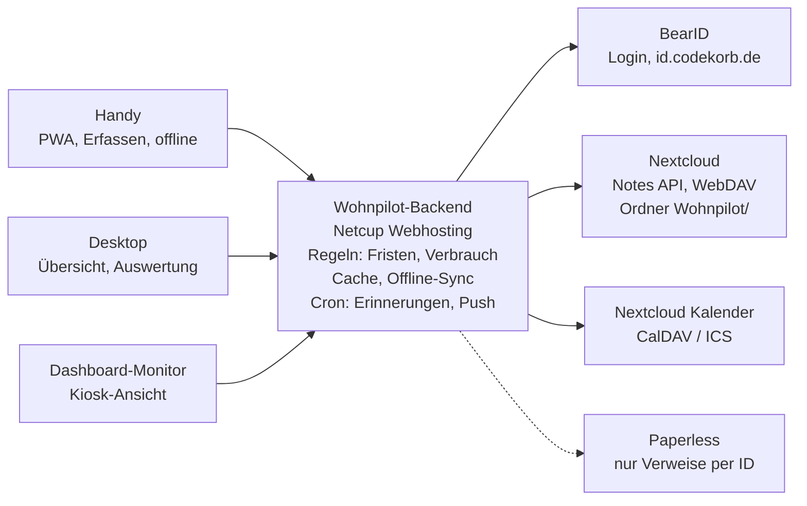

# Wohnpilot – Konzept

Stand: 24.10.2026

## Idee und Leitprinzipien

Wohnpilot ist eine Web-App, die alle haushaltsrelevanten Daten eines Mietobjekts bündelt und sie als lesbare Markdown-Notizen in der eigenen Nextcloud (cloud.codekorb.de) ablegt. Startpunkt ist das gemietete Einfamilienhaus, später soll dieselbe App ohne Umbau für eine Mietwohnung taugen.

- **Daten gehören dir, nicht der App:** Standard ist Nextcloud Notes mit Markdown und YAML-Frontmatter, alternativ SQLite oder eine Datenbank; ein Export als Markdown ist jederzeit möglich. Ohne die App bleibt alles in der Notes-App oder jedem Editor lesbar und bearbeitbar.
- **Eintragen schneller als Vergessen:** Jede häufige Eingabe, etwa ein Zählerstand, braucht höchstens drei Tipper, auch mobil im Keller ohne Netz.
- **Die App rechnet, du nicht:** Fristen, Verbräuche, Fälligkeiten und Hochrechnungen werden aus den Rohdaten abgeleitet, nicht doppelt gepflegt.
- **Mietobjekt-Denken:** Die App unterscheidet, was Mieter und was Vermieter verantworten, und dokumentiert alles, was bei Übergabe, Nebenkostenabrechnung oder Streit zählt.
- **Mehrbenutzer vorbereitet, Einzelnutzer gestartet:** Das Datenmodell kennt Haushalt und Personen von Anfang an, die Oberfläche zeigt davon erst mal nur dich.
- **Keine Geheimnisse:** Passwörter, PINs und Zugangsdaten bleiben in 1Password. Wohnpilot verweist höchstens auf den Eintrag.
- **Teil des Ökosystems:** Login über BearID, Kachel in Bear Cave, Verweise auf Paperless, Termine in den Nextcloud-Kalender, Kacheln für den Dashboard-Monitor.

## Objekt-Modell

Alles hängt an einem **Objekt** (Haus oder Wohnung), das zu einem **Haushalt** gehört. Ein Objekttyp schaltet Module und Vorlagen passend ein, sodass der Wechsel vom Haus zur Wohnung nur ein neues Objekt mit anderem Profil ist.

- **Haushalt:** Personen, die dort leben, und wer mit eintragen darf. Bleibt beim Umzug bestehen.
- **Objekt:** Adresse, Typ, Einzug, ggf. Auszug, Wohnfläche, Räume, Vermieter. Zu einem Zeitpunkt ist genau ein Objekt aktiv, alte werden archiviert, nicht gelöscht.
- **Räume und Orte:** Keller, Küche, Garten, Dachboden. Zähler, Geräte und Mängel lassen sich einem Raum zuordnen.
- **Einträge:** Alles Weitere (Zähler, Verträge, Geräte, Termine, Mängel, Wissen) gehört zu einem Objekt oder, wie Versicherungen und Handyvertrag, zum Haushalt und zieht mit um.

| Bereich | Einfamilienhaus (Miete) | Mietwohnung |
| --- | --- | --- |
| Zähler | Strom, Gas/Öl oder Wärmepumpe, Wasser, ggf. Gartenwasser, PV | Strom, ggf. Gas; Wasser und Heizung oft per Heizkostenverteiler über die Verwaltung |
| Mieterpflichten | Garten, Winterdienst, Gehweg, ggf. Mülltonnen rausstellen, Dachrinne je nach Vertrag | Treppenhaus-Reinigung laut Hausordnung, Keller, Balkon |
| Ansprechpartner | Vermieter direkt | Hausverwaltung, Hausmeister |
| Nebenkosten | Viele Verträge selbst (Müll, Wasser, Schornsteinfeger) oder Umlage | Fast alles über die Betriebskostenabrechnung |
| Termine | Schornsteinfeger, Heizungs- und Gartenarbeiten, Müllabfuhr | Ableser, Rauchmelderwartung durch Dienstleister |

Beim **Umzug** erzeugt die App aus dem alten Objekt eine Auszugs-Checkliste (Endstände ablesen, Ummeldungen, Übergabeprotokoll, Kaution zurück) und aus dem neuen eine Einzugs-Checkliste. Verträge, die zum Haushalt gehören, wandern mit, objektgebundene enden.

## Einrichtung

Beim ersten Start fragt ein kurzer Assistent nur ab, was Module, Vorlagen und Erinnerungen bestimmt. Alles bleibt später in den Einstellungen änderbar.

1. **Speicherort:** Nextcloud Notes (Standard, Daten als Markdown), SQLite auf dem Server oder eine MySQL/MariaDB-Datenbank. Alle drei hängen an derselben Speicher-Schnittstelle; ein Wechsel läuft über Export und Import.
2. **Objekt:** Haus oder Wohnung, Adresse, Einzug, Wohnfläche, Räume aus einer Vorschlagsliste zum Antippen.
3. **Heizung:** Mehrfachauswahl, weil oft kombiniert, etwa Gasheizung plus Kaminofen. Jede Wahl schaltet passende Zähler, Wartungen und Termine ein (Tabelle unten).
4. **Zähler:** Art und Anzahl, z. B. 1× Strom, 2× Wasser, 1× Gartenwasser, jeweils mit Raum. Daraus entstehen die Zähler-Einträge und die Reihenfolge der Ablese-Runde.
5. **Müll:** Tonnen mit Rhythmus oder Import des Abfuhrkalenders (ICS). Jede Tonne erscheint in ihrer Farbe (Restmüll grau, Bio braun, Papier blau, Gelbe Tonne gelb, Glas grün); die Farbe ist anpassbar, weil sie je Kommune abweicht. Schalter „Tonnen selbst rausstellen“: aus bei Vollservice, dann zeigt die App die Abholung nur als Info, ohne Erinnerung.
6. **Mieterpflichten:** Häkchen für Garten, Winterdienst, Treppenhaus und die Kleinreparaturgrenze aus dem Mietvertrag.
7. **Erinnerungen:** Push an oder aus, Kalender-Feed, Ablesetag im Monat.

| Heizform | schaltet ein |
| --- | --- |
| Gas | Gaszähler, Heizungswartung, Schornsteinfeger mit Abgasmessung |
| Öl | Tankfüllstand per Eintrag, Nachkauf mit Menge und Preis, Schornsteinfeger |
| Pellets | Lagerstand, Bestellungen mit Menge und Preis, Lagerraum reinigen, Schornsteinfeger |
| Wärmepumpe | eigener Stromzähler oder Tarif, Filter und Wartung, Wärmemengenzähler falls vorhanden |
| Fernwärme | Wärmemengenzähler, Abrechnung über Versorger oder Vermieter |
| Kamin oder Kaminofen | Schornsteinfeger mit Kehrterminen und Feuerstättenschau, Holzvorrat in Raummetern, Dichtungen und Asche prüfen |

## Module und Inhalte

Zehn Module decken den Haushalt ab; Zähler und Mietverhältnis bringen bei einem Mietobjekt den größten Nutzen und kommen zuerst.

### Zähler und Verbrauch

- Zählerart, Zählernummer, Einheit, Ort, Messstellenbetreiber, Tarif (Arbeits- und Grundpreis), Abschlag
- Ablesungen mit Datum, Wert, Foto und Anlass (regulär, Stichtag, Einzug, Auszug, Zählerwechsel)
- Zählerwechsel sauber abbilden: alter Endstand, neuer Anfangsstand, Verbrauch läuft durch
- Zweitarif-Zähler (HT/NT) und Einspeisezähler bei PV
- Plausibilitätsprüfung: kleiner als der letzte Wert, ungewöhnlicher Sprung, Ablesung überfällig
- Abgeleitet: Verbrauch pro Tag, Monat und Jahr, Vorjahresvergleich, Hochrechnung aufs Abrechnungsjahr, Kosten und ob der Abschlag reicht
- Optional Gradtagzahlen für die Heizung, damit milde und kalte Winter vergleichbar werden

### Mietverhältnis

- Mietvertrag: Beginn, Kaltmiete, Nebenkostenvorauszahlung, Staffel- oder Indexmiete, Kündigungsfrist
- Kaution: Höhe, Art (Konto, Bürgschaft), wo hinterlegt, Rückforderung beim Auszug
- Mieterhöhungen als Historie mit Datum, Grund und Prüffrist (Zustimmung binnen zwei Monaten)
- Wichtige Klauseln zum Nachschlagen: Kleinreparaturen (Einzelbetrag, Jahresgrenze), Schönheitsreparaturen, Tierhaltung, Garten
- Übergabeprotokoll Einzug mit Fotos je Raum und Zählerständen, später Grundlage für den Auszug
- Kommunikation mit dem Vermieter: Datum, Kanal, Inhalt, Antwort, Verweis aufs Schreiben in Paperless

### Nebenkosten und Betriebskostenabrechnung

- Jede Abrechnung erfassen: Zeitraum, Gesamtkosten, Vorauszahlungen, Nachzahlung oder Guthaben, neue Vorauszahlung
- Positionen je Kostenart (Wasser, Müll, Grundsteuer, Versicherung, Heizung) für den Vorjahresvergleich
- Fristen: Zugang spätestens 12 Monate nach Abrechnungszeitraum, Einwände 12 Monate nach Zugang, Belegeinsicht anfragen
- Abgleich mit eigenen Zählerständen: passt der abgerechnete Verbrauch zu dem, was du abgelesen hast
- Steuer: haushaltsnahe Dienstleistungen und Handwerkerleistungen aus der Abrechnung fürs Jahr sammeln

### Verträge und Versicherungen

- Strom, Gas, Internet, Mobilfunk, Rundfunkbeitrag, Streaming, Hausrat, Haftpflicht, Glas, ggf. Rechtsschutz
- Anbieter, Vertragsnummer, Kosten, Zahlungsrhythmus, Beginn, Mindestlaufzeit, Kündigungsfrist, Bonus-Ende
- Abgeleitet: „spätestens kündigen bis“, Erinnerung mit Vorlauf, Kosten pro Monat und Jahr gesamt
- Preisänderungen mit Sonderkündigungsrecht als eigene Frist
- Hausrat: Versicherungssumme gegen Wohnfläche prüfen (Unterversicherungsverzicht) und bei Umzug anpassen

### Geräte und Inventar

- Gerät, Hersteller, Modell, Seriennummer, Kaufdatum, Händler, Preis, Garantie- und Gewährleistungsende
- Eigentum markieren: deins oder vom Vermieter (Einbauküche, Heizung, Rauchmelder) – wichtig für Reparatur und Auszug
- Anleitung und Rechnung als Verweis auf Paperless, Ersatzteile und Verbrauchsmaterial mit Bestellnummer
- Wertvolle Dinge mit Foto als Nachweis für die Hausratversicherung

### Wartung und wiederkehrende Aufgaben

- Aufgaben mit Intervall statt festem Datum: Rauchmelder testen, Heizkörper entlüften, Siphon und Abfluss, Dunstabzugsfilter, Kaffeemaschine entkalken, Wasserfilter, Dachrinne, Rasenmäher einwintern
- Zuständigkeit: Mieter, Vermieter oder Dienstleister, damit klar ist, wen man anruft
- Saisonal: Außenwasserhahn vor Frost absperren, Gartenschlauch rein, Winterdienst-Ausrüstung prüfen
- Erledigt-Historie mit Datum, Person und Notiz, auch als Nachweis gegenüber dem Vermieter

### Termine und Pflichten am Haus

- Müllabfuhr je Tonne (Rest, Bio, Papier, Gelb) mit Rhythmus; Erinnerung zum Rausstellen nur, wenn bei der Einrichtung gewählt
- Schornsteinfeger, Heizungswartung, Ablesetermine, Rauchmelderwartung durch Dienstleister
- Mieterpflichten beim Einfamilienhaus: Winterdienst ab 7 Uhr (laut Ortssatzung), Gehweg kehren, starker Heckenschnitt nur von Oktober bis Februar (Schonzeit nach Naturschutzgesetz)
- Einmalige Termine: Handwerker, Besichtigung durch Vermieter, Sperrmüll

### Mängel und Reparaturen

- Mangel mit Raum, Fotos, Datum entdeckt, Datum gemeldet, Kanal und Status (gemeldet, bestätigt, Handwerker terminiert, behoben)
- Frist zur Mängelbeseitigung und Erinnerung zum Nachfassen
- Kleinreparaturen: Kosten pro Fall und Summe im Jahr gegen die Grenze aus dem Mietvertrag
- Bei längeren Mängeln: Zeitraum festhalten, falls eine Mietminderung im Raum steht

### Wissen und Stammdaten

- Wo ist was: Haupthahn, Gashahn, Sicherungskasten mit Belegung je Raum, FI-Schalter, Absperrventile, Heizungsanlage
- Kennwerte: Wandfarben mit Hersteller und Farbton, Glühbirnen je Lampe, Maße von Fenstern für Rollos
- Bedienung: Heizung umstellen, Rollladen einlernen, WLAN-Netzname (das Passwort steht in 1Password)
- Notfallblatt: was tun bei Wasserrohrbruch, Stromausfall, Gasgeruch, mit den wichtigsten Nummern

### Kontakte

- Vermieter, Hausverwaltung, Nachbarn mit Schlüssel, Handwerker nach Gewerk, Schornsteinfeger, Stadtwerke, Störungsnummern
- Jeder Kontakt verlinkt zu den Einträgen, in denen er vorkommt

## Erfassung

Die App ist eine PWA, die vom Homescreen startet und auf dem Handy jede häufige Eingabe in drei Schritten erledigt: Typ wählen, Wert eintragen, speichern.

- **Ein „+“ für alles:** Zentrale Schaltfläche, danach Auswahl Zählerstand, Termin, Frist, Mangel, Gerät, Notiz. Die zuletzt genutzte Auswahl steht oben.
- **Formulare aus Vorlagen:** Jeder Typ hat eine Vorlage mit Feldern, Pflichtfeldern und Vorgaben (Datum heute, Objekt aktiv). Die App schreibt Frontmatter und Tabellenzeilen, Markdown tippst du nie von Hand.
- **Zählerstand per Foto:** Foto aufnehmen, OCR schlägt die Ziffern vor, du bestätigst. Das Foto wird als Beleg an die Notiz gehängt.
- **QR-Aufkleber:** Am Zähler, am Gerät oder an der Heizung öffnet ein QR-Code direkt das passende Formular bzw. die Detailseite.
- **Offline-Warteschlange:** Ohne Netz im Keller wird lokal gespeichert und später synchronisiert, mit sichtbarem Hinweis „3 Einträge warten“.
- **Teilen-Ziel:** Über das Teilen-Menü landen Fotos, PDFs oder Text als Entwurf in der App, etwa ein Brief des Vermieters.
- **Ablese-Runde:** Ein Modus, der alle Zähler nacheinander abfragt, sortiert nach Standort (erst Keller, dann Garten).
- **Erinnerungen mit Direktsprung:** Push-Nachrichten führen direkt ins richtige Formular, etwa „Monatsende – Zählerstände ablesen“ oder „Morgen Gelbe Tonne“.
- **Nachträglich bearbeiten:** Jeder Eintrag bleibt änderbar, mit Hinweis, wer ihn wann zuletzt geändert hat.

## Übersicht und Auswertungen

Die Startseite beantwortet eine Frage: Was steht in den nächsten 30 Tagen an, und was ist schon überfällig?

- **„Was steht an“:** Fristen, Termine, Wartungen und fällige Ablesungen in einer Liste, nach Dringlichkeit sortiert (überfällig, diese Woche, bald, später).
- **Kennzahlen-Leiste:** Fixkosten pro Monat, Stromverbrauch laufender Monat gegen Vorjahr, offene Mängel, nächste Kündigungsfrist.
- **Verbrauchsdiagramme:** Monatsverbrauch je Zähler mit Vorjahreslinie, Jahreshochrechnung mit Spanne, Kosten gegen Abschläge.
- **Kalender-Feed:** ICS-Abo oder CalDAV-Schreiben in einen eigenen Kalender „Haushalt“ in Nextcloud, damit Termine im normalen Kalender erscheinen.
- **Dashboard-Kacheln:** Eine Kiosk-Ansicht ohne Navigation für den kleinen Monitor: nächste Müllabfuhr, heutige Aufgaben, Verbrauch dieses Monats.
- **Suche:** Volltext über alle Notizen, Filter nach Modul, Raum und Objekt.
- **Berichte:** Jahresbericht (Verbräuche, Kosten, erledigte Wartungen), Steuer-Export für haushaltsnahe Leistungen, Übergabemappe für den Auszug als PDF.
- **Bear Cave:** Kachel mit Zahl der offenen Punkte, Klick führt in Wohnpilot.

## Mehrbenutzer vorbereitet

Zum Start nutzt nur du die App, aber Datenmodell und Ablage sind so angelegt, dass weitere Personen ohne Umbau dazukommen.

- **Haushalt-Ordner:** Alle Daten liegen in einem Nextcloud-Ordner, der später per Nextcloud-Freigabe mit anderen geteilt werden kann.
- **Personen:** Jede Person hat eine BearID-Kennung. Einträge tragen `erstellt_von` und `geaendert_von`.
- **Rollen (später):** Verwalter (alles), Mitglied (eintragen und abhaken), Gast (nur lesen, z. B. für Haussitter das Notfallblatt).
- **Zuständigkeit:** Aufgaben und Wartungen können einer Person zugewiesen werden, Erinnerungen gehen an diese Person.
- **Private Einträge:** Ein Flag `privat: true` hält z. B. den eigenen Handyvertrag aus der gemeinsamen Ansicht.

## Datenformat in Nextcloud

Jeder Eintrag ist eine Markdown-Notiz mit YAML-Frontmatter; Ordner bilden die Module ab, Tabellen im Text halten Verläufe wie Ablesungen.

```
Wohnpilot/
  _haushalt.md            Personen, Einstellungen
  _vorlagen/              Feld-Vorlagen je Typ
  objekte/
    efh-musterstrasse/
      _objekt.md          Adresse, Typ, Einzug, Räume
      zaehler/
      mietvertrag/
      nebenkosten/
      geraete/
      wartung/
      termine/
      maengel/
      wissen/
  vertraege/              haushaltsgebunden, ziehen mit um
  kontakte/
  anhaenge/               Fotos, Belege
```

Beispiel Zähler:

```markdown
---
typ: zaehler
id: strom-haupt
objekt: efh-musterstrasse
medium: strom
zaehlernummer: 1ESY1160123456
einheit: kWh
raum: keller
ablese_intervall: monatlich
tarif: { arbeitspreis_ct: 29.8, grundpreis_eur_monat: 12.5, abschlag_eur: 85 }
erstellt_von: christian
---
| Datum      | Stand | Anlass  | Foto                    |
|------------|-------|---------|-------------------------|
| 2026-10-01 | 23456 | regulär | anhaenge/strom-2610.jpg |
| 2026-09-01 | 23210 | regulär |                         |

Zähler hängt im Keller links neben der Tür.
```

Beispiel Vertrag:

```markdown
---
typ: vertrag
id: strom-stadtwerke
kategorie: energie
anbieter: Stadtwerke
vertragsnummer: 4711-0815
kosten_eur: 85
rhythmus: monatlich
beginn: 2025-03-01
mindestlaufzeit_monate: 12
verlaengerung_monate: 1
kuendigungsfrist_wochen: 4
paperless: 1234
bezieht_sich_auf: [strom-haupt]
---
Preiserhöhung zum 01.01.2027 angekündigt, Sonderkündigung prüfen.
```

Regeln: `id` ist stabil und dient für Verweise und QR-Codes; Datumsangaben immer ISO; abgeleitete Werte (Fristende, Verbrauch) werden nie gespeichert, sondern berechnet; unbekannte Felder bleiben beim Speichern erhalten.

## Architektur

Ein schlankes Backend steht zwischen der App und Nextcloud: Es hält das Nextcloud-App-Passwort, prüft den BearID-Login, rechnet Fristen und Verbräuche und verschickt Erinnerungen.



Die gestrichelte Linie zu Paperless steht nur für Verweise per Dokument-ID; Wohnpilot liest dort nichts aus.

- **Frontend:** PWA mit Vite und Svelte oder Vue, Service Worker für Offline-Warteschlange und Push, IndexedDB als lokaler Puffer. Eine Codebasis für Handy, Desktop und Kiosk.
- **Backend:** Passend zum Netcup Webhosting PHP (z. B. Slim oder schlankes Laravel) mit SQLite als Cache und Index; Cronjob für Erinnerungen. Speicherung über austauschbare Adapter (Nextcloud Notes, SQLite, MySQL/MariaDB) hinter einer gemeinsamen Schnittstelle; Nextcloud-spezifisches wie ETag-Prüfung steckt nur im Nextcloud-Adapter. Läuft alternativ auf dem Server neben Nextcloud.
- **Login:** BearID per OIDC, Session-Cookie fürs Frontend; die Benutzerkennung landet in `erstellt_von`.
- **Nextcloud-Zugriff:** Notes API für Lesen und Schreiben von Notizen, WebDAV für Anhänge und Ordner. Ein eigenes App-Passwort, nur für Wohnpilot, jederzeit in Nextcloud widerrufbar.
- **Konfliktschutz:** Vor jedem Schreiben ETag prüfen; bei Konflikt Zusammenführen anbieten statt überschreiben.
- **Cache:** Das Backend indiziert alle Notizen in SQLite (Frontmatter und Tabellen), Auswertungen laufen auf dem Index. Abgleich per Änderungszeitpunkt, Nextcloud bleibt die Quelle der Wahrheit.
- **Parser:** Frontmatter und Markdown-Tabellen werden verlustfrei gelesen und zurückgeschrieben, damit Änderungen aus der Notes-App nicht verloren gehen.
- **OCR:** Zunächst im Browser (Tesseract.js) für Zählerziffern, das Foto wird zusätzlich als Beleg gespeichert.
- **Push:** Web Push über den Service Worker; ein Kalender-Feed als ICS-URL zusätzlich, CalDAV-Schreiben optional.

## Design

Wohnpilot verbindet das moderne App-Layout mit der Wärme des ersten Entwurfs; verbindlich für die Umsetzung ist das [Designsystem Wohnpilot](https://claude.ai/artifact/TbJTmrhEcaaYLT6pkpvpjG) mit Tokens, Komponenten und Regeln.

- **Layout:** Bento-Übersicht mit einer dunklen „Als Nächstes“-Karte, große runde Karten (24–28 px), schwebende dunkle Tab-Leiste mit Plus in der Mitte.
- **Farbe:** Papiergrund #F6F3EC, weiße Karten, Petrol #1F6F6B als Aktionsfarbe, Status ok / bald / fällig, Module als Icon-Kachel mit Tint, Tonnen in ihrer Farbe.
- **Schrift:** Geist für Text, Geist Mono für alle Zahlen und Nummern; selbst gehostet.
- **Signatur:** Rollenzähler mit dunklen Walzen und roter Nachkommastelle, Frist-Ring für Kündigungsfristen, konkrete Vorschläge statt nur Zahlen („Mit 91 € statt 85 € Abschlag gehst du auf null“).
- **Ton:** Du-Form, kurz, konkret; Chips sagen, wie dringend, Schaltflächen, was passiert.
- **Mockups:** Die [Leinwand](https://claude.ai/artifact/Y3uS94VZmg6VBDbuAhCS3i) zeigt die gewählte Richtung (Übersicht, Ablese-Runde, Zähler-Detail). Der erste, klassische Entwurf bleibt dort als Vorlage für Struktur und Inhalt von Erfassen, Vertrag, Einrichtung und Kiosk.

## Ausbaustufen

Stufe 1 liefert mit Zählern und Übersicht schon im ersten Monat Alltagsnutzen; jede weitere Stufe baut auf demselben Datenformat auf.

1. **Fundament und Zähler:** BearID-Login, Nextcloud-Anbindung, Parser für Frontmatter und Tabellen, Objekt anlegen, Zähler mit Rollenzähler-Eingabe, Ablese-Runde, Verbrauchsdiagramm, PWA installierbar.
2. **Fristen und Verträge:** Verträge, Versicherungen, Mietvertrag mit Kaution, Fristen-Lineal, Übersicht „Was steht an“, Web Push, ICS-Feed.
3. **Haus im Griff:** Wartung mit Intervallen, Termine und Müllabfuhr, Mieterpflichten, Mängel mit Status, Geräte mit Garantie.
4. **Wissen und Komfort:** Wissen und Notfallblatt, Kontakte, Suche, Offline-Warteschlange, QR-Aufkleber, OCR, Teilen-Ziel.
5. **Auswertung und Ökosystem:** Nebenkostenabrechnung mit Vergleich, Jahresbericht und Steuer-Export, Kiosk-Ansicht, Kachel in Bear Cave.
6. **Mehrere Personen und Umzug:** Rollen, Zuständigkeiten, private Einträge, Auszugs- und Einzugs-Checkliste, Objekt archivieren.

### Übergabe an Claude in der IDE

- Dieses Dokument als Markdown exportieren und als `docs/konzept.md` ins Repo legen.
- Eine `CLAUDE.md` mit Leitprinzipien, Ordnerstruktur, Frontmatter-Regeln, Design-Tokens und dem Hinweis „nur Stufe 1, keine Vorgriffe“ anlegen.
- Mit einer Test-Notiz-Sammlung starten (ein Zähler, ein Vertrag), damit der Parser gegen echte Dateien getestet wird, bevor die Oberfläche entsteht.
- Stufe für Stufe als eigene Aufgabe vergeben und am Ende jeder Stufe einmal echte Daten eintragen.

## Offene Fragen

- [ ] Name: Wohnpilot (entschieden)
- [ ] Läuft das Backend auf dem Netcup Webhosting oder auf dem Server neben Nextcloud?
- [ ] Welche Technik nutzt BearID bisher (PHP, OIDC), damit das Backend denselben Weg geht?
- [ ] Welche Heizform(en) und Zähler gibt es im Haus genau? (wird im Einrichtungsassistenten abgefragt)
- [ ] Welche Pflichten regelt dein Mietvertrag für Garten, Winterdienst und Kleinreparaturen?
- [ ] Frontend mit Svelte oder Vue?
- [ ] Sollen Termine nur als ICS-Feed kommen oder direkt per CalDAV in den Kalender geschrieben werden?
